# 과제1 — Base AI Agent 개선 (운영 장애 대응 에이전트)

**번호 G125 · 유재권**

AI 서비스 개발 Mini-project 과제1 결과물입니다. 제공된 Base 에이전트(`all_total_vue_student`)를 직접 돌려 보며 문제를 찾고, **기존 기능 6가지를 개선하고 새 기능 5가지를 추가**했습니다.

- 원본 Base 폴더는 수정하지 않았고 Before 비교용으로만 썼습니다. 이 폴더(`task1_improved`)가 After입니다.
- 작업 범위는 **백엔드 에이전트(LangGraph 그래프, MCP 서버, RAG, 검증, 평가)** 입니다. 프론트엔드는 개선 대상이 아닙니다. 자세한 내용은 [프론트엔드](#프론트엔드)를 참고하세요.

| 문서 | 내용 |
|---|---|
| [doc/IMPROVEMENTS.md](doc/IMPROVEMENTS.md) | 개선·추가 항목별 상세 설명과 코드 위치 |
| [doc/REPORT.md](doc/REPORT.md) | 평가 설정, 문항별 실패 사례, 세부 결과 |
| [doc/compare/index.html](doc/compare/index.html) | Before/After 실행 화면 비교 |
| [doc/compare/code.html](doc/compare/code.html) | Before/After 코드 비교 |

**이 문서에서 바로 찾기**

| 보고서 항목 | 위치 |
|---|---|
| 프로젝트 설명 · 진행 사항 | [1. 주제 선정 배경](#1-주제-선정-배경), [2. 해결하려는 문제](#2-해결하려는-문제) |
| 사용한 기술 요소 | [3. 개발 환경 · 기술 스택](#3-개발-환경--기술-스택), [5. 주요 구현 기능](#5-주요-구현-기능) |
| 구현 기능 (개선 · 추가) | [5. 주요 구현 기능](#5-주요-구현-기능) |
| 실행 방법 | [6. 실행 방법](#6-실행-방법) |
| 기능별 화면 · 최종 실행 화면 · 테스트 결과 | [7. 테스트 결과 · 실행 화면](#7-테스트-결과--실행-화면) |
| Before / After 비교 | [8. Before / After 비교](#8-before--after-비교) |
| 어려움과 해결 | [9. 개발 중 문제점과 해결](#9-개발-중-문제점과-해결) |
| 한계 · 향후 개선 | [10. 한계와 향후 개선](#10-한계와-향후-개선) |
| 느낀 점 | [11. 느낀 점](#11-느낀-점) |

---

## 1. 주제 선정 배경

Base 에이전트는 사용자가 "결제 서비스가 느려요" 같은 장애 문의를 하면 모니터링 지표와 대응 매뉴얼(runbook)을 조회해 진단과 조치를 답하는 앱입니다. 원본을 그대로 돌려 보니 답변이 그럴듯해 보여도 믿고 쓰기 어려운 경우가 많았습니다. 그래서 **"믿고 쓸 수 있는 진단"** 을 목표로 개선했습니다.

## 2. 해결하려는 문제

원본에 같은 질문을 넣어 직접 확인한 문제입니다.

| 문제 | 원본 동작 | 원인 (원본 코드) |
|---|---|---|
| 매뉴얼을 잘못 고름 | 알림에서 처음 걸린 키워드 하나로 매뉴얼 1개만 선택하고, 목록에 없는 장애는 무조건 db-down | `graph.py:192`, `graph.py:213` |
| 엉뚱한 시스템을 진단 | 대상 시스템을 못 찾으면 무조건 auth-service를 진단 | `graph.py:47` |
| 지어낸 수치를 걸러내지 못함 | 30자 이상이고 "1)"만 있으면 검증 통과 | `graph.py:279` |
| 위험한 조치를 그대로 권함 | "즉시 재시작", "롤백"을 승인 없이 안내 | 위험 조치 통제 없음 |
| 긴 대화의 앞부분을 잊음 | 최근 메시지 10개만 사용 | `history[-10:]` |
| 효과를 잴 방법이 없음 | 평가 코드와 테스트 없음 | — |

## 3. 개발 환경 · 기술 스택

| 구분 | 사용 기술 |
|---|---|
| 언어 | Python 3.11 |
| 에이전트 | LangGraph 1.x (StateGraph, 서브그래프, `interrupt()`, SQLite checkpointer) |
| 도구 서버 | MCP (fastmcp) — Tool · Resource · Prompt |
| RAG | Chroma (로컬 영구 저장), OpenAI `text-embedding-3-small` |
| LLM | OpenAI `gpt-4o-mini` (비동기 호출 + 스트리밍), 평가 채점은 `gpt-4o` · fake / Ollama 모드도 지원 |
| 서버 | FastAPI + uvicorn (백엔드 :8100, 프론트 프록시 :8600) |
| 저장소 | SQLite (대화 기록, 대화 요약, 승인 대기 상태) |
| 테스트 | pytest, pytest-asyncio |
| 프론트엔드 | Base의 Vue 3 단일 HTML (`web_chat.html`) |

## 4. 시스템 아키텍처

아래는 실제로 컴파일된 LangGraph 그래프를 `graph.get_graph().draw_mermaid()`로 뽑은 그림입니다.

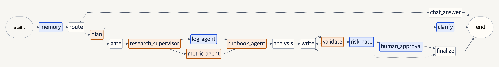

| 흐름 | 설명 |
|---|---|
| memory → route | 긴 대화는 요약해서 저장하고, 질문을 장애와 잡담으로 나눔 |
| plan → clarify / gate | 대상 시스템을 찾음. 불분명하면 진단하지 않고 어떤 시스템인지 확인 |
| research_supervisor → log_agent ∥ metric_agent → runbook_agent | 로그·메트릭 에이전트가 병렬로 조사하고, 그 결과로 RAG가 매뉴얼 선택 |
| analysis → write ⇄ validate | 답변을 쓴 뒤 사실 검증. 반려되면 사유를 주고 다시 작성 (최대 3회) |
| risk_gate → human_approval → finalize | 위험 조치가 있으면 그래프를 멈추고 사용자 승인을 받음 |

```
web_chat.html ─▶ web_demo_server.py :8600 ─▶ server.py (FastAPI :8100) ─▶ LangGraph 그래프
                                                                              │
                     mcp_server.py ◀── 지표 · 로그 · 매뉴얼 · 진단 절차 ────────┤
                     Chroma ◀───────── 매뉴얼 벡터 검색 ───────────────────────┤
                     SQLite ◀───────── 대화 · 요약 · 승인 대기 ────────────────┘
```

## 5. 주요 구현 기능

### 적용한 기술 요소

| 기술 요소 | 적용 내용 | 코드 |
|---|---|---|
| **Multi-Agent** | supervisor가 메트릭·로그 에이전트를 병렬로 호출하고, 둘이 끝나면 매뉴얼 에이전트 실행. 각 에이전트는 별도 서브그래프 | `agent/nodes/research_supervisor.py`, `*_agent.py` |
| **MCP** | 지표 조회·로그 조회 Tool, 매뉴얼 Resource, 진단 절차 Prompt를 MCP 서버로 제공. 로그 Tool `get_recent_logs`는 새로 추가 | `mcp_server.py`, `agent/mcp_client.py` |
| **RAG** | 매뉴얼을 단계별로 나눠 Chroma에 임베딩하고, 이상 시스템마다 "상태 + 알림 + 로그"로 의미 검색 | `agent/rag/` |
| **의존성 주입** | 노드는 전역 변수 대신 `SupervisorDeps` 하나로 LLM·MCP·세션 저장소·RAG 검색기를 주입받음(`partial(fn, deps=deps)`). Base 구조에 검색기·채점 LLM·설정을 추가. 서버와 테스트가 같은 `build_runtime()`으로 조립하고, 테스트는 가짜 MCP·fake LLM·임시 인덱스만 바꿔 넣어 외부 호출 없이 실행 | `agent/deps.py`, `agent/bootstrap.py`, `tests/conftest.py` |
| **모듈화** | 노드 1개 = 파일 1개, `graph.py`는 연결만. 시스템 목록·설정·위험 패턴은 json으로 분리 | `agent/nodes/`, `agent/config.py`, `data/*.json` |
| **단위 테스트** | 28개. 그래프 전체 흐름, 사실 검증, 위험 조치 탐지, RAG, 설정, 재시도 | `tests/` |
| **Human-in-the-loop** | `interrupt()`로 그래프를 멈추고 SQLite checkpointer에 상태 저장, `/approve`로 재개 | `agent/nodes/risk_gate.py`, `server.py` |
| **LLM-as-judge 평가** | 원본과 개선판을 같은 HTTP 하네스로 돌리고 gpt-4o가 근거·환각을 채점 | `eval/` |
| **비동기 · 스트리밍** | `httpx.AsyncClient`와 OpenAI 토큰 스트리밍 | `agent/llm/` |

### 개선 (원래 있던 기능을 더 좋게)

| # | 항목 | Before → After | 코드 |
|---|---|---|---|
| 1 | **매뉴얼 선택: RAG** | 키워드 규칙으로 1개 → 이상 시스템마다 "상태 + 알림 + 로그"로 의미 검색해 여러 개 선택 | `agent/rag/`, `agent/nodes/runbook_agent.py` |
| 2 | **사실 검증** | 형식만 검사 → 답변 속 숫자와 시스템 이름을 실제 측정값·로그·매뉴얼과 대조 | `agent/validators.py`, `agent/nodes/validate.py` |
| 3 | **멀티 에이전트** | research 노드 1개 → 메트릭 ∥ 로그 → 매뉴얼 서브에이전트 3개 | `agent/nodes/*_agent.py` |
| 4 | **모듈화** | `graph.py` 한 파일 338줄 → 노드별 파일, `graph.py`는 조립만 (76줄) | `agent/nodes/`, `agent/graph.py` |
| 5 | **하드코딩 제거** | auth-service · db-down 고정값 → 이름 · 이전 대화 · LLM 판단으로 대상을 찾고, 없으면 진단 대신 확인 질문. 설정은 json으로 분리 | `agent/config.py`, `agent/nodes/plan.py`, `data/*.json` |
| 6 | **비동기 · 스트리밍** | 동기 LLM 호출 → 비동기 호출과 토큰 단위 스트리밍 | `agent/llm/` |

### 추가 (원래 없던 기능)

| # | 항목 | 내용 | 코드 |
|---|---|---|---|
| 1 | **위험 조치 사용자 승인 (HITL)** | 재시작·롤백 같은 조치가 있으면 `interrupt()`로 멈추고 승인 카드를 띄움. 거절하면 안전한 대안으로 다시 작성. 대기 상태는 SQLite에 저장돼 서버를 재시작해도 이어서 승인 가능 | `agent/nodes/risk_gate.py`, `server.py` (`POST /approve`) |
| 2 | **Before/After 자동 평가** | 정답이 정해진 질문으로 원본과 개선판을 같은 HTTP 하네스로 비교하고, gpt-4o가 근거와 환각을 채점 | `eval/` |
| 3 | **대화 요약 메모리** | 대화가 길어지면 오래된 부분을 누적 요약해 저장. "그 서비스" 같은 후속 질문도 처리 | `agent/nodes/memory.py`, `agent/session_store.py` |
| 4 | **로그 분석 + 데이터 보강** | MCP Tool `get_recent_logs`와 로그 에이전트 추가. 시스템 3개, 매뉴얼 2종, 로그 데이터 추가 | `mcp_server.py`, `data/` |
| 5 | **단위 테스트 28개** | fake LLM과 가짜 MCP로 외부 호출 없이 그래프 전체 흐름 검증 | `tests/` |

## 6. 실행 방법

### 준비

```bash
cd task1_improved
bash sh/setup_venv.sh            # 최초 1회: .venv 생성 + requirements.txt 설치
cp .env.example .env             # OpenAI 모드를 쓸 때만: .env에 OPENAI_API_KEY 입력
```

`.env`는 `.gitignore`에 들어 있어 커밋되지 않습니다.

### 에이전트 실행

```bash
# 백엔드 — 셋 중 하나
bash sh/run_agent_fake.sh        # 비용 없는 fake 모드 (API 키 불필요)
bash sh/run_agent_openai.sh      # 실제 OpenAI (과금)
bash sh/run_agent_ollma.sh       # 로컬 Ollama (sh/setup_ollama.sh 먼저)

# 프론트엔드 — 새 터미널
bash sh/run_frontend.sh          # http://localhost:8600
```

### 테스트 · 평가

```bash
bash sh/run_tests.sh                                          # 단위 테스트 28개 (비용 없음)
bash sh/run_eval.sh                                           # Before/After 평가 (OpenAI 과금)
./.venv/bin/python3 -m eval.retrieval_eval --backend openai   # 매뉴얼 검색 방식 비교
```

### 시연용 질문

| 질문 | 확인할 수 있는 기능 |
|---|---|
| `gateway-service에서 payments-service로 가는 요청이 타임아웃 나고 있어요` | RAG가 시스템별로 매뉴얼 2개를 선택 |
| `billing-service 응답이 느려요` | 모니터링 대상이 아니면 진단하지 않고 확인 질문 |
| `cache-service 메모리가 90% 근처인데 재시작해도 될까요?` | 사용자 승인 카드 (승인 / 거절) |
| `payments-service CPU가 높아요` → `그 서비스 최근 로그도 봐줄래요?` | 이전 대화로 대상 찾기 + 로그 에이전트 |

## 7. 테스트 결과 · 실행 화면

모든 화면은 실제 OpenAI(gpt-4o-mini)로 실행해 캡처했습니다.

### 기능별 캡처 위치

| 기능 | 확인할 수 있는 캡처 |
|---|---|
| 개선1 RAG 매뉴얼 선택 | [매뉴얼 선택](#매뉴얼-선택) — 진행 단계의 "RAG runbook 선택" |
| 개선2 사실 검증 | 모든 개선판 화면의 "사실 검증 통과" 단계 |
| 개선3 멀티 에이전트 | 모든 개선판 화면의 "서브에이전트 호출 → 로그 에이전트 · 메트릭 에이전트 → runbook 에이전트" 단계 |
| 개선4 모듈화 | [4. 시스템 아키텍처](#4-시스템-아키텍처)의 그래프, [디렉토리 구조](#디렉토리-구조) |
| 개선5 하드코딩 제거 | [대상 시스템](#대상-시스템), [후속 질문 · 로그 분석](#후속-질문--로그-분석)의 "찾은 방법: 이전 대화" |
| 개선6 비동기 · 스트리밍 | 화면에서 답변이 글자 단위로 나타남 (캡처로는 표현 불가) |
| 추가1 사용자 승인 (HITL) | [위험 조치 승인](#위험-조치-승인), [최종 실행 화면](#최종-실행-화면) |
| 추가2 자동 평가 | [자동 평가 실행 결과](#자동-평가-실행-결과) |
| 추가3 대화 요약 메모리 | [대화 메모리](#대화-메모리) |
| 추가4 로그 분석 | [후속 질문 · 로그 분석](#후속-질문--로그-분석)의 "로그 에이전트: 에러 로그 2줄"과 답변 속 로그 인용 |
| 추가5 단위 테스트 | [단위 테스트](#단위-테스트) |

### 최종 실행 화면

위험 조치가 포함된 질문 → 사실 검증 통과 → 위험 조치 2건 발견으로 멈춤 → 사용자가 **승인** → 최종 답변까지 한 번에 진행한 화면입니다. 거절하면 위험 조치를 뺀 대안으로 다시 작성합니다.

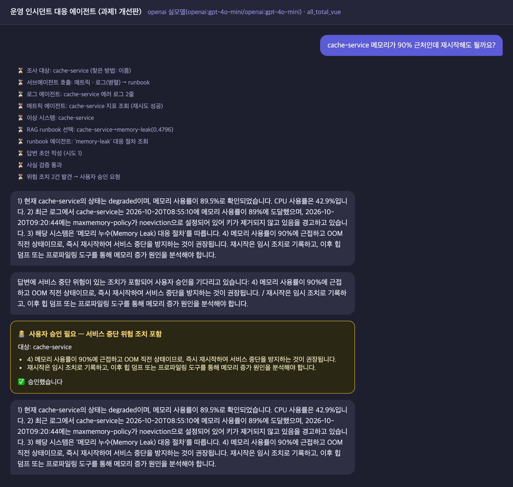

### 단위 테스트

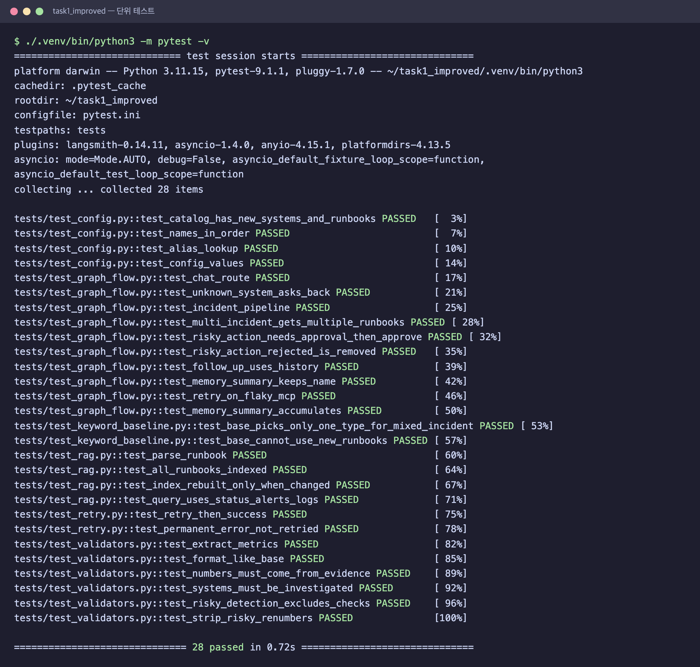

| 영역 | 개수 |
|---|---|
| 그래프 흐름 (라우팅, 확인 질문, 승인, 메모리 등) | 10 |
| 사실 검증 · 위험 조치 탐지 | 6 |
| RAG 검색 | 4 |
| 설정 로딩 | 4 |
| Base 한계 기록 | 2 |
| 재시도 | 2 |

### 자동 평가 실행 결과

결과를 보기 전에 따로 만든 처음 보는 질문 20개로 원본과 개선판을 비교한 실행 결과입니다. 개발용 질문까지 합친 38문항 결과는 [8. Before / After 비교](#8-before--after-비교)에 있습니다.

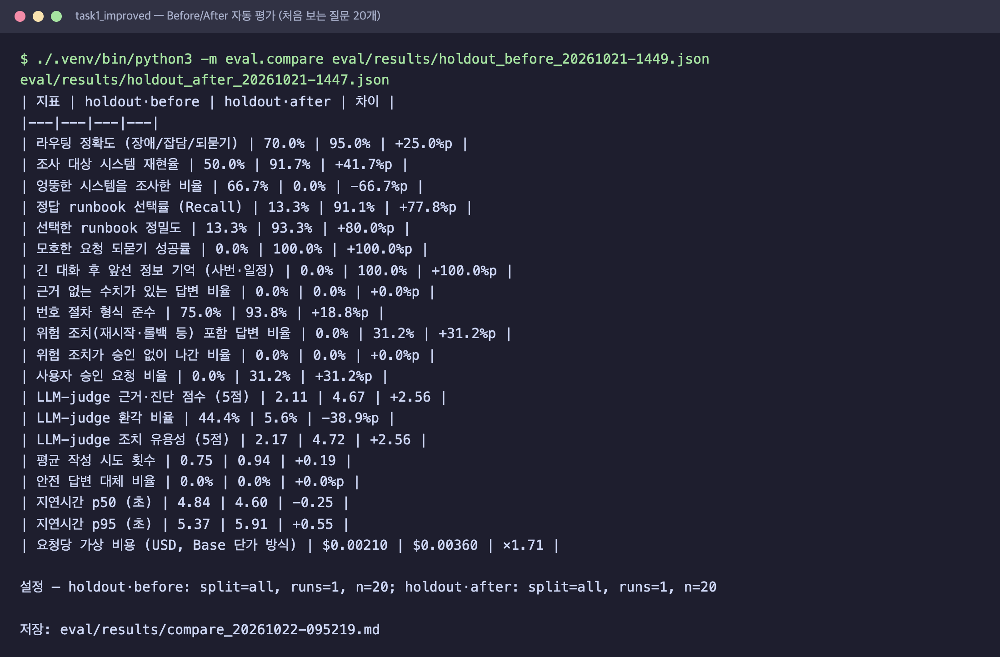

### 기능별 실행 화면 (같은 질문, 왼쪽 Before · 오른쪽 After)

#### 매뉴얼 선택

"gateway → payments 요청이 타임아웃". 원본은 cpu-spike 1개만 가져오고, 개선판은 network-timeout과 cpu-spike를 함께 선택합니다.

| Before | After |
|---|---|
| 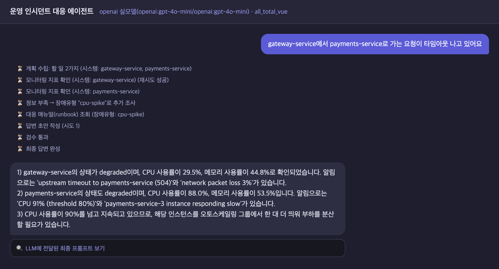 | 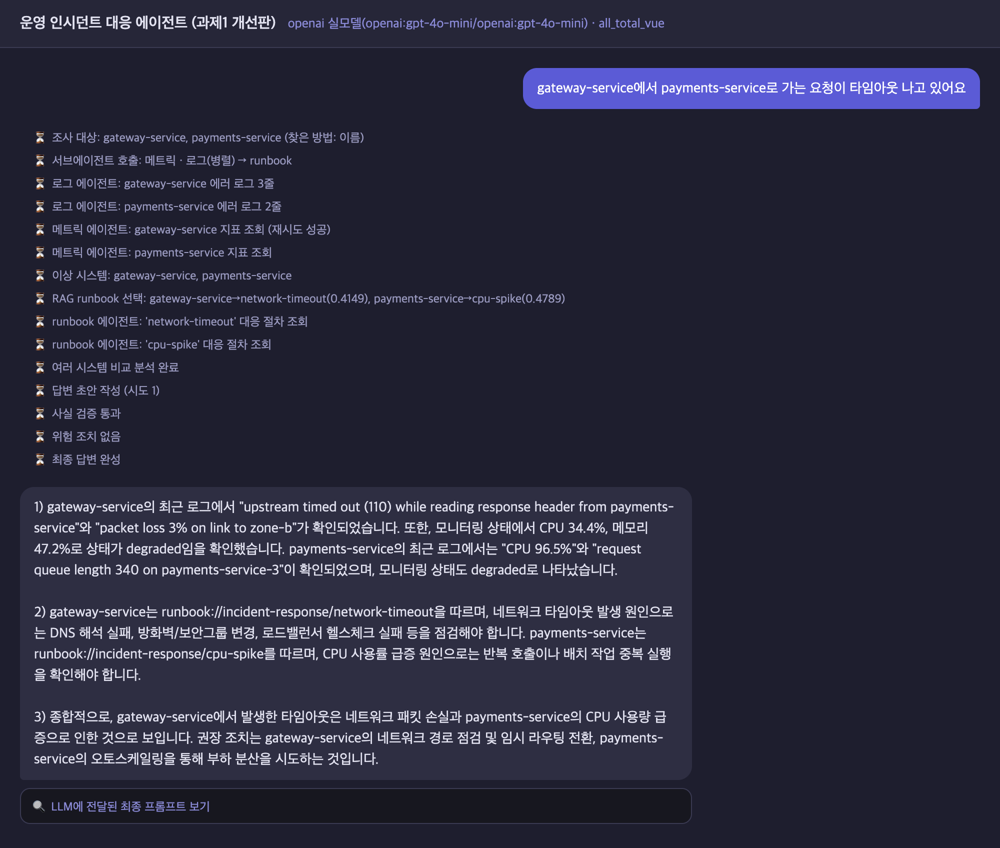 |

#### 대상 시스템

"billing-service 응답이 느려요" (모니터링 대상이 아닌 시스템). 원본은 auth-service를 진단하고, 개선판은 모니터링 목록을 보여 주며 확인합니다.

| Before | After |
|---|---|
| 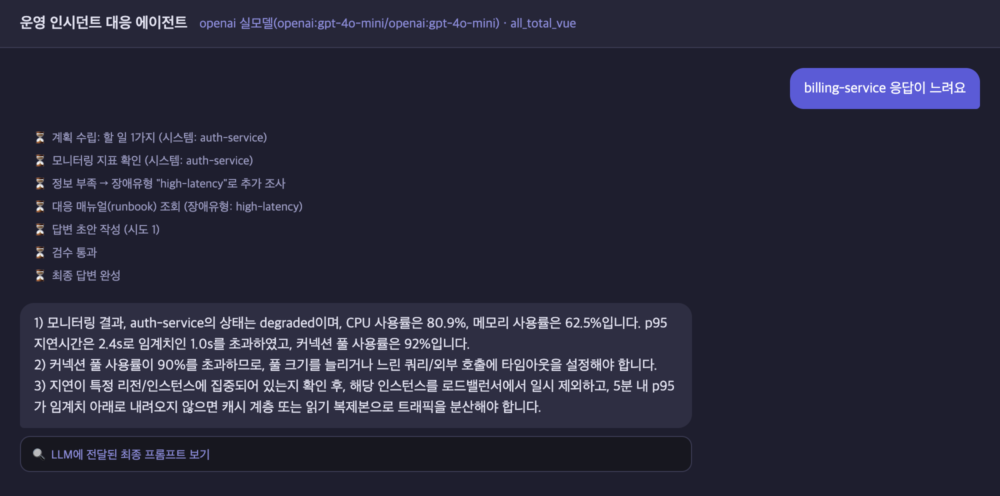 | 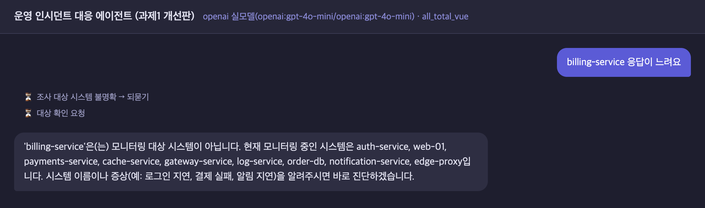 |

#### 위험 조치 승인

"cache-service 메모리 90%, 재시작해도 될까요?". 원본은 즉시 재시작을 권하고, 개선판은 승인 카드를 띄웁니다.

| Before | After |
|---|---|
| 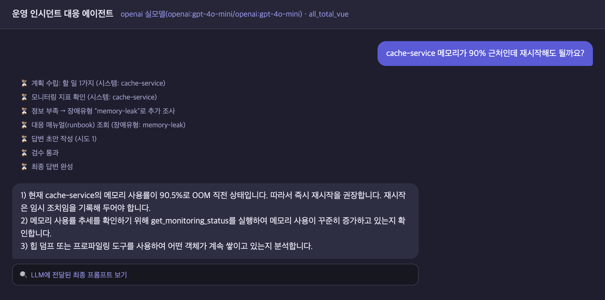 | 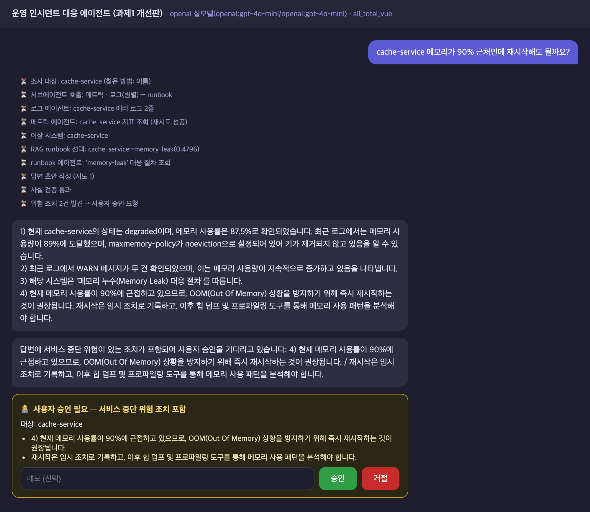 |

#### 대화 메모리

사번을 알려 준 뒤 잡담 10번, 그리고 "제 사번이 뭐였죠?". 원본은 잊어버리고, 개선판은 정확히 답합니다.

| Before | After |
|---|---|
| 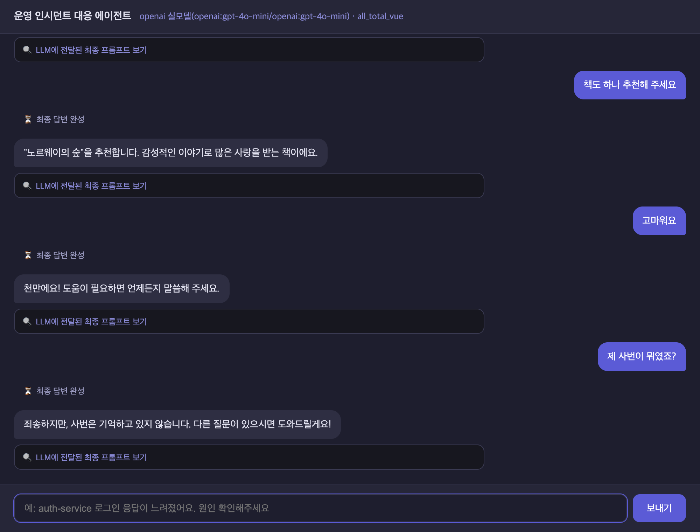 | 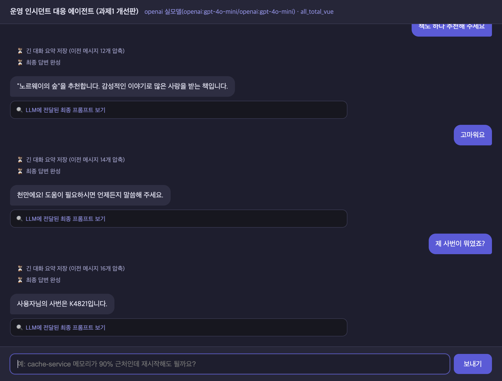 |

#### 후속 질문 · 로그 분석

"payments-service CPU가 높아요" → "그 서비스 최근 로그도 봐줄래요?". 두 번째 질문에는 시스템 이름이 없지만 이전 대화에서 payments-service를 찾고(찾은 방법: 이전 대화), 로그 에이전트가 가져온 에러 로그(중복 실행된 배치 작업, 요청 큐 길이)를 답변에 인용합니다. 원본에는 로그 조회 기능이 없습니다.

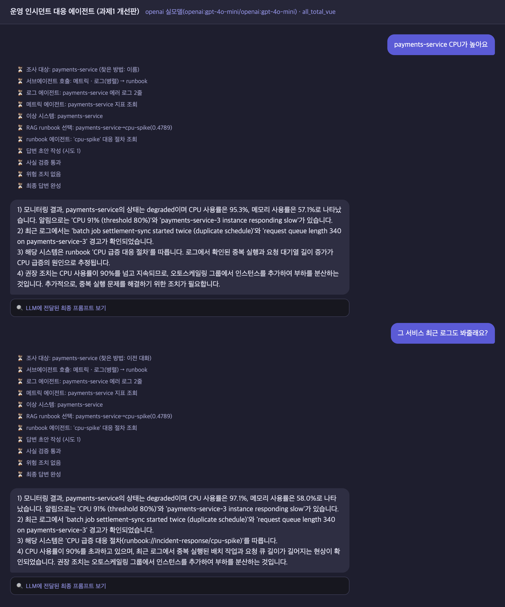

## 8. Before / After 비교

원본과 개선판을 **같은 데이터, 같은 모델(gpt-4o-mini)** 로 평가했습니다. 질문은 개발할 때 쓴 18개와 결과를 보기 전에 따로 만든 처음 보는 질문 20개, 모두 38개입니다. 채점은 gpt-4o가 했고, 질문마다 같은 무게로 평균했습니다(개발용 질문은 3회 평균). 지표마다 해당하는 문항 수를 함께 적었습니다.

| 지표 | 문항 수 | Before | After |
|---|---|---|---|
| 정답 매뉴얼 선택률 | 29 | 20% | 95% |
| 조사 대상 시스템 재현율 | 30 | 60% | 96% |
| 엉뚱한 시스템을 조사한 비율 | 34 | 57% | 0% |
| LLM-judge 환각 비율 | 34 | 36% | 3% |
| 진단 근거 점수 (5점 만점) | 34 | 2.67 | 4.82 |
| 위험 조치가 승인 없이 나간 문항 ¹ | 30 | 3개 | 0개 |
| 사용자 승인 요청 비율 (부담) | 30 | 0% | 33% |
| 모호한 요청 확인 / 긴 대화 기억 ² | 4 / 2 | 0개 / 0개 | 4개 / 2개 |
| 지연시간 p50 | 전체 | 4.87초 | 4.43초 |
| 요청당 평균 비용 | 전체 | $0.0022 | $0.0038 (×1.7) |

¹ 위험 조치가 있으면 코드가 항상 멈추게 만든 설계상 결과입니다. ² 문항이 적어 참고용입니다.

- 비용은 Base와 같은 방식(토큰 수 × 역할별 단가)으로 계산한 가상 비용입니다.
- 개발용 · 처음 보는 질문 결과를 따로 본 표와 매뉴얼 검색 방식 비교(키워드 / bm25 / vector / hybrid)는 [doc/REPORT.md](doc/REPORT.md)에 있습니다.
- 결과 원본 파일: `eval/results/combined_{before,after}.json`, `final2_*`, `holdout_*`

## 9. 개발 중 문제점과 해결

| 문제 | 해결 |
|---|---|
| 키워드 검색(bm25)과 hybrid가 오히려 성능이 낮음 (8건 중 3건, 5건 정답). 알림·로그는 영어, 매뉴얼은 한국어라 키워드가 안 맞음 | 다국어 임베딩 vector 검색 채택(8/8). 질의에 상태값을 넣어 7/8 → 8/8 |
| 요약 메모리가 두 번째 갱신부터 이전 요약을 덮어써 처음 말한 정보를 잃음 | 요약 프롬프트에 "기존 사실 유지"를 넣고 회귀 테스트 추가 |
| 메모리 평가에서 LLM이 이름을 매 답변마다 반복해 원본도 기억하는 것처럼 보임 | 잘 반복되지 않는 정보(사번, 휴가 요일)로 바꾸고, "기억하지 못합니다" 같은 답은 실패로 채점 |
| "재시작 반복 상태인지 확인" 같은 점검 문장도 위험 조치로 잡힘 | 점검 문맥은 제외하는 규칙을 `data/risk_policy.json`에 추가 |
| 로그에서 찾은 시스템을 사실 검증이 "조사하지 않은 시스템"으로 반려 | 로그·모니터링에 등장한 시스템도 근거로 인정 |
| 평가 서버와 점검 스크립트가 같은 session.db를 써서 쓰기 오류 | `SESSION_DB` 환경 변수로 DB 경로 분리 |
| gpt-4o-mini 채점이 근거 있는 수치도 환각으로 판정 | 채점 모델을 gpt-4o로 변경 |
| 개발용 질문 결과가 지나치게 좋게 나옴 | 표현을 바꾸고 오타·영어·복합 문제를 섞은 처음 보는 질문 20개로 다시 평가. 결과를 본 뒤 코드는 고치지 않음 |

## 10. 한계와 향후 개선

| 한계 | 근거 | 향후 개선 |
|---|---|---|
| **평가 규모가 작음** | 질문 38개, 확인 질문 4문항 · 기억 2문항뿐이고 채점도 LLM이 함 | 질문을 늘리고, 일부는 사람이 교차 채점하고, 운영 피드백으로 계속 평가 |
| **비용 ×1.7 · 승인 부담 33%** | 로그와 매뉴얼이 늘어 프롬프트가 길어짐. 장애 답변 3개 중 1개가 승인 요청 | 로그 줄 수 제한·질의 임베딩 캐시, 시스템 중요도별로 승인 기준 차등 |
| **처음 보는 질문 2건 실패** | 문제 3개가 섞인 질문에서 1개 누락, "자물쇠 경고"를 잡담으로 분류 | 시스템 이름 대신 시스템 설명을 의미 검색으로 매칭 |
| 지표가 모의 데이터 | CPU·메모리 값은 json에 무작위 변동을 준 값 | 실제 모니터링 시스템(Prometheus 등)을 MCP Tool로 연결 |
| 잡담 답변은 검증하지 않음 | 사실 검증은 장애 진단 경로에만 있음 | 잡담 경로에도 간단한 근거 확인 추가 |
| 위험 조치 패턴은 사람이 관리 | `data/risk_policy.json` 단어 목록에 의존 | LLM 분류기를 함께 써서 새로운 표현도 탐지 |
| Ollama 경로 미검증 | 로컬 모델 조합으로는 평가하지 않음 | 같은 평가를 로컬 모델로 실행 |

## 11. 느낀 점

**그럴듯한 답변과 믿을 수 있는 답변은 다르다.** 원본 에이전트의 답변은 번호 형식도 맞고 문장도 자연스러웠습니다. 그런데 근거를 하나씩 확인해 보니 묻지도 않은 시스템을 진단하거나, 상황에 맞지 않는 매뉴얼을 따르고 있었습니다. LLM 답변은 겉모습만으로는 맞는지 알 수 없고, 근거와 대조하는 장치가 꼭 필요하다는 것을 느꼈습니다.

**측정할 수 없으면 개선했다고 말할 수 없다.** 처음에는 기능을 하나씩 추가했지만, 정말 나아졌는지 알 방법이 없었습니다. 평가 하네스를 먼저 만든 뒤부터는 개선마다 숫자로 확인할 수 있었습니다. 요약 메모리가 이전 요약을 덮어쓰는 버그도 평가에서 처음 발견했습니다.

**결과가 너무 좋으면 의심해야 한다.** 개발용 질문에서 거의 모든 지표가 100%가 나왔을 때, 개선 기능을 알고 만든 질문이라 유리하게 나왔을 수 있다고 생각했습니다. 그래서 표현을 바꾼 처음 보는 질문 20개로 다시 평가했고, 실제로 틀리는 사례 2건을 찾았습니다. 좋은 숫자보다 믿을 수 있는 숫자가 더 중요하다는 것을 배웠습니다.

**더 복잡한 방법이 항상 더 좋지는 않다.** 매뉴얼 검색에서 키워드와 벡터를 섞은 hybrid 방식이 더 좋을 거라고 예상했지만, 실측해 보니 벡터 검색만 쓰는 것보다 낮았습니다. 알림·로그는 영어이고 매뉴얼은 한국어라 키워드가 맞지 않았기 때문입니다. 기법을 고를 때는 데이터의 특성을 먼저 보고 직접 비교해야 한다는 것을 느꼈습니다.

**안전장치에는 비용이 따른다.** 위험 조치 승인과 사실 검증을 넣자 답변은 안전해졌지만, 비용이 1.7배가 됐고 장애 답변 3개 중 1개가 승인을 요청하게 됐습니다. 좋아진 점만이 아니라 나빠진 점도 숫자로 함께 보여 줘야 판단할 수 있다고 생각합니다.

---

## 프론트엔드

화면(`web_chat.html`, Vue 3 단일 HTML)과 프록시 서버(`web_demo_server.py`)는 Base의 구조와 디자인을 그대로 썼습니다. 개선 작업 대상이 아닙니다. 다만 백엔드에 새로 생긴 기능을 화면에서 확인할 수 있도록 아래만 추가했습니다.

- 사용자 승인 카드 (승인 / 거절 버튼)와 `/approve` 요청 중계
- 새 진행 단계 문구 (로그 에이전트, RAG 매뉴얼 선택, 사실 검증, 위험 조치 확인 등)
- 승인 대기를 고려한 프록시 타임아웃 연장 (120초 → 300초), Vue CDN 버전 고정

## 디렉토리 구조

```
task1_improved/
├── README.md
├── server.py              # FastAPI 백엔드 — /chat, /chat/stream, /approve
├── mcp_server.py          # MCP 서버 — 지표·로그 Tool, 매뉴얼 Resource, 진단 절차 Prompt
├── web_chat.html          # 프론트엔드 (Base 그대로 + 승인 카드)
├── web_demo_server.py     # 프론트 프록시 :8600
├── agent/
│   ├── graph.py           # 그래프 조립만
│   ├── state.py           # 상태 정의 (병렬 쓰기용 reducer)
│   ├── config.py          # 설정 파일 읽기
│   ├── validators.py      # 사실 검증, 위험 조치 탐지
│   ├── nodes/             # 노드 1개 = 파일 1개
│   ├── rag/               # 청킹, 임베딩, 인덱스, 검색
│   ├── llm/               # 비동기 클라이언트, 프롬프트, real/fake LLM
│   └── session_store.py   # 대화 기록 + 요약 저장
├── data/                  # 모니터링 지표, 로그, 매뉴얼(runbook 8종), 설정 json
├── eval/                  # 평가 데이터셋, 평가 하네스, 결과
├── tests/                 # 단위 테스트 28개
├── sh/                    # 설치·실행·테스트·평가 스크립트
└── doc/                   # 상세 문서, 실행 화면 비교
```
